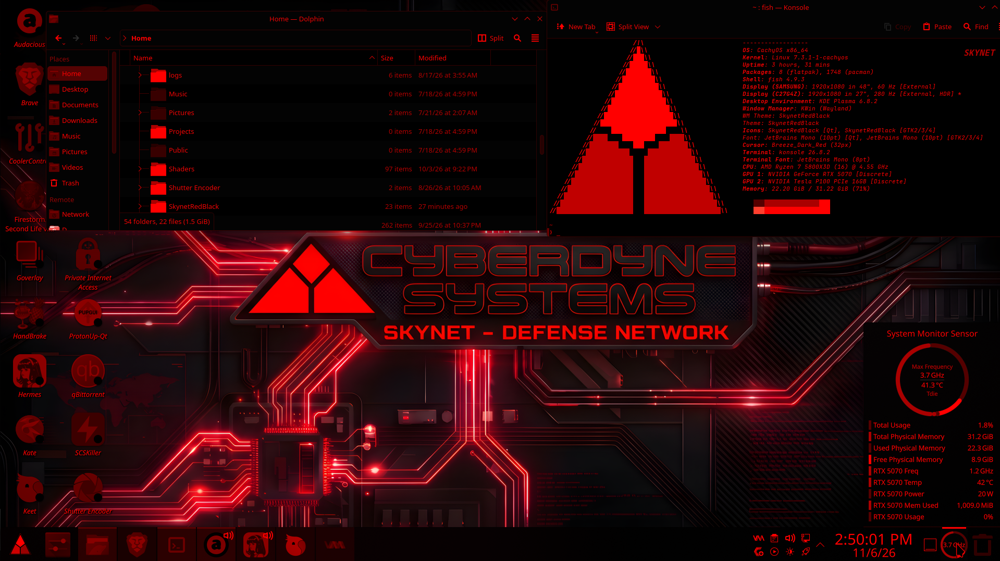

# SkynetRedBlack

A red-on-black Cyberdyne / Skynet themed **global theme for KDE Plasma 6** —
colour scheme, redscale icon theme, Papirus-Folders, Konsole profile,
wallpaper, and a triforce fastfetch greeting, all in one package.



## Screenshots


## What's inside

| Component | Source in this repo | Installs to |
|---|---|---|
| Global theme (Look-and-Feel) | `look-and-feel/com.skynetredblack/` | `~/.local/share/plasma/look-and-feel/` |
| Icon theme `SkynetRedBlack` | `icons/SkynetRedBlack/` | `~/.local/share/icons/` |
| Colour scheme `SkynetRedBlack` | `colorschemes/SkynetRedBlack.colors` | `~/.local/share/color-schemes/` |
| Konsole colour scheme `SkynetRedBlack` | `konsole/SkynetRedBlack.colorscheme` | `~/.local/share/konsole/` |
| Konsole profile `SkynetRedBlack` | `konsole/SkynetRedBlack.profile` | `~/.local/share/konsole/` |
| Cursor theme `Breeze_Dark_Red` | `cursors/Breeze_Dark_Red/` | `~/.icons/` |
| Wallpaper | `wallpaper/skynet-wallpaper.jpg` | `~/.local/share/wallpapers/SkynetRedBlack/` |
| fastfetch triforce logo | `fastfetch/skynet.txt`, `skynet.json` | `~/fastfetch/` |
| fish greeting fragment | `fish/config-fragment.fish` | `~/.config/fish/config.fish` (append) |
| Panel/desktop layout (optional) | `extras/layouts/org.kde.plasma.desktop-layout.js` | `look-and-feel/.../contents/layouts/` (already included) |
| Desktop containment override (red labels) | `plasmoids/org.kde.desktopcontainment/` | `~/.local/share/plasma/plasmoids/` |

The icon theme is a redscale tint of the user's installed app icons
(luminance → muted red, symbolic/system icons → bright red) plus
Tela red folders (`#ef5350`) shoehorned into `folder`, `inode-directory`,
drive, and trash icons. The colour scheme is pure black backgrounds
with bright red foregrounds. The Konsole profile is red-on-black
with a bright red cursor.

## Quick install (whole shabang)

```bash
git clone https://github.com/kd0frg/SkynetRedBlack.git
cd SkynetRedBlack
./install.sh
```

`install.sh` copies every component to its correct location, rebuilds
the icon cache, sets the wallpaper, installs the fish greeting, and
installs the global theme with `kpackagetool6`. Then log out/in (or
restart Plasma: `systemctl --user restart plasma-plasmashell.service`).

## Install the global theme alone (KDE Store style)

```bash
kpackagetool6 --type Plasma/LookAndFeel --install SkynetRedBlack-lookandfeel.tar.gz
# or: System Settings -> Appearance -> Global Theme -> Install from File
```

Then select **SkynetRedBlack** in Global Themes.
Note: a global theme package only carries *defaults* (colour scheme
name, icon theme name, widget style). The actual colour scheme and
icon theme files must be installed too — `install.sh` does that, or
install the separate tarballs below.

## Separate tarballs (for KDE Store submission)

In `releases/` (built by `install.sh --pack` or manually):

- `SkynetRedBlack-lookandfeel.tar.gz` — Plasma/LookAndFeel package
- `SkynetRedBlack-icons.tar.gz` — icon theme (SkynetRedBlack)
- `SkynetRedBlack-colorscheme.tar.gz` — colour scheme
- `SkynetRedBlack-konsole.tar.gz` — Konsole scheme + profile
- `SkynetRedBlack-cursor.tar.gz` — Breeze_Dark_Red cursor theme
- `SkynetRedBlack-wallpaper.tar.gz` — wallpaper

**Can it go on KDE Store? Yes** — upload is manual (store.kde.org →
Publish). Status (verified against the Plasma look-and-feel package
spec: `KPackageStructure: Plasma/LookAndFeel` in `metadata.json`,
preview at `contents/previews/preview.png`):

- ✅ `metadata.json`: Id, Name, Category, Description, Authors
  (ProjectAIvolution <kd0frg@gmail.com>), Version, trimmed License
  (`MIT / GPL-3.0 / LGPL-3.0 (see LICENSE)`), Keywords
- ✅ Tarball structure: `com.skynetredblack/` root, installs via
  `kpackagetool6 --type Plasma/LookAndFeel`
- ⚠️ Preview is 762x728 — store shows fine, a 1920x1200 screenshot
  looks better; replace `contents/previews/preview.png` if you capture one
- ⚠️ `Website` empty in metadata (optional); wallpaper tarball is a
  bare JPG — KDE Store wallpapers take the image directly, OK
- Submission order: upload icon theme, colour scheme, Konsole and
  wallpaper first, note their store IDs, then add
  `"X-KPackage-Dependencies": ["kns://icons.knsrc/api.kde-look.org/<id>", …]`
  to the global theme's `metadata.json` before uploading it (so the
  global theme pulls its components in automatically).

## Requirements

- KDE Plasma 6 (tested on 6.8, CachyOS)
- Breeze widget style (stock) — the defaults deliberately use Breeze,
  not a third-party Plasma style, so it works on a stock install.
  The author's own desktop also uses the Darkly Plasma style; swap
  `plasmarc`/`kwinrc` in `contents/defaults` for Darkly if you have it.
- `fastfetch` (optional, for the greeting), `fish` (optional)

## Credits — special thanks

This theme stands on the shoulders of the Linux community. Huge thanks to:

- **Breeze Dark Red cursor (the mouse this theme settled on)** — originally by **fbm224**, packaged by **Erwin-Iosef**: https://github.com/Erwin-Iosef/Breeze-Dark-Red (KDE Store: https://store.kde.org/p/2108645, GPL). It is a red recolour of the stock Breeze cursor by the **KDE Visual Design Group**: https://github.com/KDE/breeze — thank you both, this cursor is the perfect match for the red-on-black look.
- **Breeze** (Plasma style, widget style, and the base cursor artwork) — **KDE Visual Design Group**: https://github.com/KDE/breeze
- **Tela icon theme** — **Vince Liuice (vinceliuice)**: https://github.com/vinceliuice/Tela-icon-theme (GPL-3.0). Its red folder artwork is shoehorned into this theme's folders.
- **Papirus icon theme + papirus-folders** — **PapirusDevelopmentTeam**, folder-colour script by **Sergei Eremenko (SmartFinn)**: https://github.com/PapirusDevelopmentTeam/papirus-icon-theme · https://github.com/PapirusDevelopmentTeam/papirus-folders — the red Papirus folders in Dolphin come from their `papirus-folders` tool.
- **KDE Plasma 6** — the **KDE Community**: https://kde.org — desktop, Dolphin, Konsole, and KWin that make this theme possible.
- **JetBrains Mono** (Konsole profile font) — **JetBrains**: https://github.com/JetBrains/JetBrainsMono

The cursor theme is bundled in `cursors/Breeze_Dark_Red/` (and as `SkynetRedBlack-cursor.tar.gz`) under its GPL terms, with attribution retained. All other assets are tinted derivatives of the above, redistributed under their respective licenses — check each project's license before commercial use.

## License

The full license is posted in this repository as `LICENSE` (root) with
verbatim third-party license texts under `LICENSES/` — see that file
for the authoritative wording. Summary:

- **Your own code/scripts/colour scheme/Konsole/defaults — MIT**
  (install.sh, scripts/, colourschemes/, konsole/, look-and-feel/
  metadata/defaults, plasma-style/ colors, plasmoid override,
  fastfetch/fish fragments, wallpaper). Full MIT text is in LICENSE.
- **Tinted icon artwork — NOT MIT.** This package redistributes
  tinted derivatives under their upstream licenses:
  - Tela icon theme (folders, Steam) — **GPL-3.0**, © vinceliuice
  - Papirus icon theme + papirus-folders (red folders) — **GPL-3.0**,
    © PapirusDevelopmentTeam / Sergei Eremenko
  - Breeze icons (all status/actions/panel/symbolic/apps tints) —
    **LGPL-3.0**, © KDE Community
  - Breeze_Dark_Red cursor (GPL, fbm224/Erwin-Iosef) — **GPL**,
    attribution retained
  - JetBrains Mono (Konsole font) — SIL OFL (referenced, not bundled)

  Because the icon tarball as shipped contains GPL/LGPL
  derivatives, it cannot be covered by a blanket MIT grant.
  The MIT grant above applies only to the author's original
  material; the GPL/LGPL parts remain under GPL-3.0 / LGPL-3.0
  (verbatim texts in `LICENSES/GPL-3.0.txt` and
  `LICENSES/LGPL-3.0.txt`). Check each upstream project's
  license before commercial use.

## Update log
- v1.0.1: Fixed DaVinci Resolve in the start menu (menu *category* `DaVinciResolve.directory` pointed at `/opt/resolve/graphics/DV_Resolve.png`, bypassing the theme — now shadowed to the tinted PNG), plus tinted PNG copies for the hicolor fallback. Fixed System/Wine category icons (Text-monochrome/gradient Breeze icons went dark — now boosted bright red like the other categories), bright-red trash and CachyOS updater icons, Tela red folders including `inode-directory` (Dolphin main pane), and the triforce fastfetch logo matching the wallpaper Y-junction emblem.

- v1.0.2: Triangle launcher icon — the giant red circle Kickoff button is now the wallpaper Y-junction triforce as a clean SVG (`cyberdyne-triangle`, bright red top diamond + darker bottom sections, black Y gaps), set as the Kickoff icon by install.sh. Hermes/Kate/Keet app icons retinted from muted coral-pink (luminance-soft) to pure bright red, matching the symbolic/system icons. All previous fixes (DaVinci directory shadow, System/Wine bright categories, Tela red folders + inode-directory, bright trash/cachy) retained.
- v1.0.3: Unified ALL app icons to one bright pure-red tint (luminance remapped 140-255, G=B=0 — no pink/salmon, no dark maroon outliers like Steam/Blender/GIMP/Brave/Discord/FileZilla/Firefox/Audacious/Audacity/Kdenlive/Mixxx/HandBrake). Brave contrast preserved via luminance (white shield 255 vs orange lion ~185). Symlink/link icons toned down to muted dark red. Also earlier: DaVinci directory shadow, System/Wine bright categories, Tela red folders + inode-directory, bright trash/cachy, triangle launcher, triforce fastfetch.
- v1.0.4: App icons darkened to uniform dark red (luminance remapped 40-140, pure red, no pink/no bright), symlink/link icons made black. All other fixes retained.
- v1.0.5: Widget/toolbar symbolic+panel icons darkened to match dark-red app icons (was bright pure red). DaVinci Resolve desktop/menu icons switched to the tinted SVG (real .desktop copies, not symlinks, no black symlink overlay) via absolute Icon= paths in both the app and directory shadows.
- v1.0.6: All symlink and new-file emblem overlays made black in the global theme package — `emblem-link`, `emblem-new`, `emblem-noread`, plus new `link_overlay.svg` / `symlink.svg` icon names (Plasma's LinkOverlay lookup) in black, so any symlink or new file created under this theme shows a black mini-icon instead of red/pink. Icons tarball and look-and-feel tarball rebuilt.
- v1.0.7: Auto-retint for future apps. A Plasma global theme is a static package - it cannot tint icons that don't exist yet. This package therefore ships `scripts/retint-new-icons.py` (installed as `cyberdyne-retint`): after installing any new app, run it and every new Icon= name gets tinted to the same dark red (40-140) and cached. It runs the FULL icon pipeline — titlebar minis, Breeze widget/system icons, tray icons, preferences icons, copy icons, folder index, DaVinci emblems and the system-wide SVG scan — not just app icons (`--apps-only` limits it to app Icon= names). Optional `--with-auto-retint` in install.sh enables a systemd user timer (5min after boot, then weekly) that does it automatically. Symlink/new-file emblems remain black.
- v1.0.8: All folder icons darkened to uniform dark red (2,101 files) — sidebar places (Desktop/Documents/Downloads/etc), Dolphin main-pane `folder`/`inode-directory` (incl. preview-capable folders), user/system folders, trash-folder variants. Symlink/new emblems remain black, app icons remain dark red.
- v1.0.9: Folders via Papirus-Folders method — ran `papirus-folders -C red --theme Papirus-Dark` (capital -C), then copied all 986 Papirus `folder-red-*` / `user-red-*` icons (all sizes incl. 16px, which papirus-folders itself skips) into SkynetRedBlack, tinted to uniform dark red. This replaces the earlier Tela folder shoehorn for Dolphin sidebar + main pane, preview and non-preview folders alike.
- v1.0.9: Active-app highlight fixed — live kdeglobals had Darkly-derived pink colours (ForegroundLink 248,177,181, Selection 122,25,39) overriding SkynetRedBlack, giving Hermes' taskbar highlight a pinkish tint. Removed pinks, set Selection background to brighter dark red (140,0,0) so active apps read slightly brighter than inactive (black), set [General] ColorScheme=SkynetRedBlack, and synced the packaged SkynetRedBlack.colors. Also: all folders dark red via Papirus-Folders red (see v1.0.8 note), auto-retint script for future apps.
- v1.0.10: Taskbar fixed — SkynetRedBlack Plasma style now ships a proper `colors` file (Breeze-dark black base, Selection/active highlight maroon 90,0,0, pure-red links) instead of tinting the whole taskbar red/pink. plasmarc Theme=SkynetRedBlack in global theme defaults. Active apps read slightly brighter maroon than inactive dark-red icons, no pink.
- v1.0.11: Taskbar/clock/system-monitor colours — desktoptheme base changed to pure black backgrounds (0,0,0) with bright red text (255,0,0), so the taskbar is black (not grey), clock and system-monitor font are bright red (not white), active highlight remains maroon.
- v1.0.12: Active-task highlight is now the brightest clock red (255,0,0), not pink/purple/maroon — desktoptheme Selection + WM active background/blend set to 255,0,0, purple `ForegroundVisited=155,89,182` and white Selection/Button backgrounds removed, colour scheme Selection/WM synced to 255,0,0, global-theme defaults set `AccentColor=255,0,0` + `accentColorFromWallpaper=false`, and `install.sh` clears stale pink/white inline kdeglobals overrides. `metadata.json` version synced to 1.0.12 (was 1.0.6). All release tarballs rebuilt.
- v1.0.13: Dolphin white toolbar icons + white breadcrumb text fixed — root causes: (1) `~/.config/dolphinrc` `[Icons] Theme=CyberKDE` per-app override (CyberKDE/Breeze-Dark fallbacks are white `#fcfcfc`) — now pointed at `SkynetRedBlack`, and `install.sh` fixes it on install; (2) `SkynetRedBlack.colors` was missing `[Colors:Header]`/`[Colors:Header][Inactive]`, so Dolphin's toolbar/breadcrumb fell back to Breeze Dark white — both sections added (black bg, `255,0,0` text) and scheme re-applied. All `actions` toolbar icons in SkynetRedBlack retinted to bright pure red `#FF0000` (was dark maroon), cache rebuilt. Desktop-icon label text follows the same Window/Header palettes, now red.
- v1.0.14: Desktop icon labels (Audacious, Brave, OBS Studio, …) white → bright red. Root cause was upstream-hardcoded, not a palette: `org.kde.desktopcontainment/contents/ui/FolderItemDelegate.qml` returns `"white"` for root-view labels, ignoring the colour scheme. Fix ships a user-level plasmoid override (`plasmoids/org.kde.desktopcontainment/`, installed by `install.sh` to `~/.local/share/plasma/plasmoids/`) with that one line changed to `"#ff0000"`. Verified on a show-desktop screenshot: white label pixels dropped from thousands to ~30, labels render bright red.
- v1.0.15: Wallpaper re-done @ 3840x2160 — new Cyberdyne Systems / Skynet Defense Network circuit artwork, colours tweaked to better match the SkynetRedBlack colour scheme (black base, bright clock red). Replaces the previous Skynet circuit wallpaper in `wallpaper/skynet-wallpaper.jpg` and the wallpaper tarball.
- v1.0.16: Wallpaper resolution correction — replaced with the 5K source (`Skynet-5k-Wallpaper_upscaled.png`, 4000x2232) downsized to exactly 3840x2160 (Lanczos, JPEG q92) in `wallpaper/skynet-wallpaper.jpg`, so the shipped wallpaper is a true 4K downscale rather than an upscale of a smaller file.
- v1.0.17: Hermes desktop icon retinted to match the rest of the set — it was the lone bright pure-red (255,0,0) outlier while Kate/qBittorrent/SCSKiller sit in dark maroon (avg ~67-101). Re-tinted from the original hicolor source with the theme's uniform dark-red mapping (luminance -> 40-140, G=B=0): background 140,0,0, silhouette 40,0,0, avg 98 — now in line with the other icons. Updated in the live theme (all sizes) and `icons-overlay/SkynetRedBlack.png`; icons tarball rebuilt.
- v1.0.18: Bundled the cursor theme — `Breeze_Dark_Red` (the cursor this theme settled on, `cursorTheme` + `cursorSize=32` in global-theme defaults) is now shipped in `cursors/Breeze_Dark_Red/` and as `SkynetRedBlack-cursor.tar.gz`, installed by `install.sh` to `~/.icons/`. Added a Credits section to the README thanking the Linux community contributors behind the bundled assets (Breeze Dark Red cursor, Breeze, Tela, Papirus/papirus-folders, KDE Plasma, JetBrains Mono) with creator names and GitHub links.
- v1.0.19: Disabled/greyed-out icons are now maroon instead of grey — `[ColorEffects:Disabled]` in the colour scheme and Plasma style changed from grey (`128,128,128`, blend 0.5, which greyed out Konsole's Copy button and any other unselectable icon) to dark maroon (`60,0,0`, blend 0.7), so disabled icons land at ~118,0,0 like the darker theme icons. Scheme re-applied and shell restarted.
- v1.0.20: Disabled *icon pixmaps* maroon too — the scheme effect alone didn't reach Konsole's Copy icon (still grey `43,43,43`): KDE's `KIconEffect` defaults every icon group's Disabled state to grey (`togray`), read per-app from each app's rc file. Set `DisabledEffect=colorize, DisabledValue=0.7, DisabledColor=60,0,0, DisabledSemiTransparent=false` for all six groups (Desktop/Toolbar/MainToolbar/Small/Panel/Dialog) in kdeglobals, konsolerc, dolphinrc, katerc, gwenviewrc and arkrc; `install.sh` writes them on install and the global-theme defaults carry them in kdeglobals.
- v1.0.21: Copy squares dark red like the disabled "Copy" text — the two overlapping squares of Konsole's Copy button still rendered dark grey `43,43,43` while the text went maroon, because the v1.0.20 per-app `KIconEffect` colorize settings aren't reliably applied on the symbolic/disabled-pixmap path. Fixed at the source: all 76 `*copy*` action icons (`edit-copy`, `editcopy`, `edit-copy-path`, `edit-copy-symbolic`, `stock_copy`, `gtk-copy`, … in 16/22/24, `actions/16|22` and `symbolic/actions`) recoloured from bright `#ff0000` to `#3c0000` (60,0,0 — the exact `DisabledColor`/disabled text colour), so the squares land on `60,0,0` in every rendering path (verified by rendering: dominant pixel `60,0,0`, matching the maroon text). Also added the missing `32/actions`, `48/actions` and `scalable/actions` sizes (previously only 16/22/24 existed, inviting a grey Breeze fallback at toolbar sizes) and registered them in `index.theme`. Fix ships as `scripts/fix-copy-icon.py`, run by `install.sh` on the installed theme, and is baked into the rebuilt icons tarball. `metadata.json` bumped to 1.0.21; all release tarballs rebuilt.
- v1.0.22: Installer Kickoff fix made idempotent — the `icon=cyberdyne-triangle` insertion in `install.sh` now dedupes existing lines and only inserts when missing (previously every install appended another copy; live `appletsrc` cleaned to a single line). Also fixed the final `cp` in `install.sh` failing when `~/.local/bin/cyberdyne-retint` is a symlink to the repo copy. Note: after reinstalling icons the running Plasma shell keeps stale icon state (panel icons revert to normal colours, triangle/Hermes taskbar icons can vanish) until it reloads — restart it with `systemctl --user restart plasma-plasmashell.service`. `metadata.json` bumped to 1.0.22; look-and-feel tarball rebuilt.
- v1.0.23: DaVinci Resolve icon + desktop-plastering fix — `install.sh` no longer copies `DaVinciResolve.desktop` to `~/Desktop` (ever; it now also removes that file if present), and the DaVinci menu shadows (`applications/` + `desktop-directories/`) are only installed when `/opt/resolve/bin/resolve` actually exists, so a user without Resolve gets no broken menu entry and a user with an empty desktop gets nothing plastered on it — the theme only supplies icon files, it never creates desktop icons. DaVinci icon itself regenerated from the clean dark-red SVG in every size (theme + hicolor, live + repo): removes the salmon-pink `#ff5959` highlight / white dot that was in the hicolor fallback PNGs/SVG. Added black symlink emblems (`emblem-link`, `link_overlay`, `symlink`, `emblem-new`, `emblem-symbolic-link`) at 32/48px — previously only 16/22/scalable existed, so desktop-size lookups fell back to light inherited emblems (the white dot / pink symlink overlay); now black at every size. Fix ships as `scripts/fix-davinci-icon.py`, run by `install.sh`. `metadata.json` bumped to 1.0.23; icons + look-and-feel tarballs rebuilt.
- v1.0.24: Copy squares brightened — v1.0.21 had set the two overlapping squares to `#3c0000` (60,0,0) to match the disabled "Copy" text, but at luminance ~18 on black they were effectively invisible (darker to the eye than the grey `43,43,43` they replaced). Now `#8c0000` (140,0,0): luminance ~42, as visible as the old grey, still dark red, top of the theme's dark-red app-icon range (40-140) — verified by rendering on black. `scripts/fix-copy-icon.py` handles upgrades from both `#ff0000` and `#3c0000`. `metadata.json` bumped to 1.0.24; icons + look-and-feel tarballs rebuilt.
- v1.0.25: Konsole greeting readout fixed — the fastfetch `WM Theme:` and `Theme:` lines now read `SkynetRedBlack` (was `Darkly` / `Breeze (SkynetRedBlack) [Qt], MacTahoe-Dark [GTK2/3/4]`). Done via custom fastfetch modules in `fastfetch/skynet.json`, **not** by changing system settings: your actual KWin decorations stay Darkly, widget style stays Breeze, and GTK stays MacTahoe-Dark (there is no GTK/widget theme named SkynetRedBlack to point them at — pointing them there would break GTK apps). Also made the logo path relative (`skynet.txt` next to the config) so installs work for any username, not just `/home/cole`. `metadata.json` bumped to 1.0.25; look-and-feel tarball rebuilt.
- v1.0.26: Triangle logo restored — v1.0.25's relative logo path (`skynet.txt`) broke the greeting: fastfetch resolves relative paths from the current directory, not the config folder, so Konsole (opening in `$HOME`) couldn't find it and fell back to the default logo. Logo source is now `$HOME/fastfetch/skynet.txt` (fastfetch expands `$HOME`, so it works from any directory and any username). `metadata.json` bumped to 1.0.26; look-and-feel tarball rebuilt.
- v1.0.27: Wallpaper revision 3 — replaced `wallpaper/skynet-wallpaper.jpg` with `Skynet-5K-Rev3-Wallpaper.png` (4000x2232 source) downsized to exactly 3840x2160 with Lanczos resampling, saved as JPEG quality 100, same method as the v1.0.16 4K correction. Wallpaper tarball rebuilt; `install.sh` copies it to `~/.local/share/wallpapers/SkynetRedBlack/`. `metadata.json` bumped to 1.0.27; look-and-feel tarball rebuilt.
- v1.0.28: Folder icons fixed — some Dolphin folders showed flat blue Breeze folders (`#3daee9`) instead of dark red. Root cause was twofold: (1) `index.theme` was missing the `[96/places]`, `[128/places]` and `[256/places]` sections even though those directories exist, so KDE ignored them — now completed via `scripts/fix-folder-index.py` (run by `install.sh`, idempotent); (2) Dolphin was running through several icon-cache rebuilds and kept a stale icon loader that fell back to Breeze — verified fixed by relaunching Dolphin, all folders dark red again. Note: after future icon-cache rebuilds, restart Dolphin (and the Plasma shell) to pick up fresh icons. `metadata.json` bumped to 1.0.28; icons + look-and-feel tarballs rebuilt.
- v1.0.29: Installer no longer deletes the live icon theme — `install.sh` used to `rm -rf ~/.local/share/icons/SkynetRedBlack` before extracting the tarball, so running apps (Dolphin, Plasma) briefly lost the theme mid-install, fell back to blue Breeze folders/icons, and never recovered until restarted (this is what made Dolphin folders revert to blue after running the installer). Icons are now staged in a temp dir and copied in place, so the theme directory never vanishes. Note: apps already running during an install can still cache stale icons — restart Dolphin and the Plasma shell after installing if anything looks off. `metadata.json` bumped to 1.0.29; look-and-feel tarball rebuilt.
- v1.0.30: Greeting `Font:` line now reads JetBrains Mono — the built-in `font` module reports the system Qt/GTK font (Noto Sans), while JetBrains Mono is the Konsole profile's terminal font. Replaced with a custom fastfetch module printing `Font: JetBrains Mono (10pt) [Qt], JetBrains Mono (10pt) [GTK2/3/4]`, same readout approach as the v1.0.25 Theme lines; actual desktop fonts unchanged. `metadata.json` bumped to 1.0.30; look-and-feel tarball rebuilt.
- v1.0.31: Mini titlebar icons tinted — window titlebar (16px, upper-left) icons are looked up by app-ID/desktop basename (`org.kde.konsole`, `brave-browser`, `gimp`, `org.kde.kate`, …), many of which were missing from SkynetRedBlack, so they fell back to Tela/Breeze originals (grey Konsole `#72787e`, bright Brave `#fd4932`) mismatching the dark-red large icons. New `scripts/fix-mini-icons.py` (run by `install.sh`) finds every desktop `Icon=` name + app-ID alias missing from the theme, resolves aliases whose `Icon=` already points into the theme (Hermes → `SkynetRedBlack`, DaVinci → `davinci-resolve`, …), otherwise tints the source icon with the theme mapping (luminance → 40-140, G=B=0) in all sizes. Audit after: 389 icons at 16px, 0 not red-tinted, 0 missing vs 48px. `metadata.json` bumped to 1.0.31; icons + look-and-feel tarballs rebuilt.
- v1.0.32: Hermes icon restored — the v1.0.31 mini-icon alias step re-tinted already-red theme icons, double-darkening them (Hermes background 140→56, silhouette 40→44, contrast crushed 100→12, so it looked flat/not fully tinted). Aliases whose `Icon=` already resolves inside the theme are now **plain copies**, never re-tints. Also, the Hermes app rewrites its own `.desktop` file with `Icon=hermes` (was `SkynetRedBlack`), which resolved to the black/white hicolor original — the theme now ships `hermes` + `com.nousresearch.hermes` as exact copies of `SkynetRedBlack.png` (140/40, verified by md5). `metadata.json` bumped to 1.0.32; icons + look-and-feel tarballs rebuilt.
- v1.0.33: Whole Breeze set tinted in — every Breeze icon (all contexts, sizes 16-96 + 128/256/512 where present, 19,836 entries incl. symlink-resolved sizes) that was missing from SkynetRedBlack is now tinted and bundled: actions/symbolic → bright red `#ff0000` (theme convention), everything else → dark red (luminance → 40-140, G=B=0). Existing theme icons kept. `index.theme` completed with the new size/context sections (preferences, applets, categories, devices, status, mimetypes, actions at 32/48/64, …). Ships as `scripts/tint-breeze.py`, run by `install.sh`; nothing falls back to Breeze colours at any size now. `metadata.json` bumped to 1.0.33; icons + look-and-feel tarballs rebuilt.
- v1.0.34: Kickoff menu bright icons fixed — `DLSS5VKLayer Helper` and `Emoji Selector` (both use `preferences-desktop*` icons) rendered bright red with a white strip while everything else was dark maroon. Cause: stale bright `#ff0000` copies in `<size>/preferences/` (22/24px, including `#fff` 3-digit gradient stops that the 6-digit tint regex missed) won KDE lookup order over the dark `<size>/apps/` copies. New `scripts/normalize-preferences.py` (run by `install.sh`) re-tints every non-dark-red preferences icon from Breeze (345 + 80 files, incl. 3-digit hex), and `index.theme` Directories is rewritten alphabetically so `apps/` consistently precedes `preferences/` per size. `metadata.json` bumped to 1.0.34; icons + look-and-feel tarballs rebuilt.
- v1.0.35: Tray icons fixed to bright red — cachy-update normal (checkmark) now dark red (luminance 40-108), updates-available is brightest red alert (V-map max(R,G,B), avg 208 / max 255), steam retinted V-map from Tela-red-dark (background #770000, head #ff0000, avg 133) + steam_tray* solid #ff0000, and all 82 audio-volume icons bright #ff0000 (avg 255, was #450000 avg 68). Root cause: dark-red luminance mapping crushed cyan/green originals to near-black (#280000-#6c0000) and left steam/audio indistinguishable from disabled. Fix ships as `scripts/fix-tray-icons.py` (run by `install.sh`, idempotent, regenerates from hicolor/Tela originals — never re-tints already-bright files). Also ships bright `icons-overlay/steam.svg`. `metadata.json` bumped to 1.0.35; icons + look-and-feel tarballs rebuilt.
- v1.0.36: License posted properly — added root LICENSE (MIT for author's own code/scripts/scheme/defaults, with GPL-3.0 for Tela/Papirus/cursor artwork and LGPL-3.0 for Breeze icons, verbatim texts in LICENSES/GPL-3.0.txt + LGPL-3.0.txt) and THIRD-PARTY-NOTICES.md. The old blanket 'MIT' claim was inaccurate for the icon tarball as shipped (it contains GPL/LGPL derivatives that cannot be re-licensed MIT). `metadata.json` License field now reads 'MIT (code) / GPL-3.0 / LGPL-3.0 (icon artwork) — see LICENSE', version bumped to 1.0.36. Look-and-feel tarball rebuilt.
- v1.0.37: Window buttons bright red — minimize/maximize/close rendered white in Brave and other apps. Root cause is two layers: (1) KWin SSD buttons were white because the Darkly decoration library (`org.kde.darkly`) hardcodes white and ignores the desktoptheme; `install.sh` now points KWin at `library=org.kde.breeze` + `theme=SkynetRedBlack` (and `contents/defaults` carries the same), whose `[WM]` active/inactive foregrounds are `255,0,0` — inactive buttons were grey `161,169,177`, now bright red too. (2) Brave/Chromium draws its own client-side white glyphs on the tab bar, which no KDE theme can recolour; new `scripts/set-brave-system-titlebar.py` sets `browser.custom_chrome_frame=false` ("Use system title bar") so Brave uses the red KWin SSD buttons — it refuses to edit while Brave is running (Brave would discard the edit on exit). `metadata.json` bumped to 1.0.37; look-and-feel tarball rebuilt.
|- v1.0.39: System-wide SVG icon scan — during install, `scan-all-icons.py` now walks the ENTIRE filesystem (/ and /home) for *.svg icon files and tints every one not already in SkynetRedBlack (user themes, third-party icon packs, custom icons, flatpak icons, etc.). Progress bar shows "Scanning all SVG icons on the system..." with real-time count/percentage. The installer now automatically restarts the Plasma shell at the end (`systemctl --user restart plasma-plasmashell.service`) so all changes take effect immediately — no manual restart needed. The retint script (`retint-new-icons.py`) now tints widget/panel/tray icons BRIGHT RED (#ff0000) instead of dark red: `--bright` flag available for full bright-red retint. All widget icon name patterns documented (system-panel, audio-volume, network, battery, power, media, dialog, panel, tray, kickoff, etc.).
|- v1.0.40: Fix the icon tinting tool (`retint-new-icons.py`) to correctly identify widget icons (fixing a bug where hyphens were being replaced by spaces), and update the installer (`install.sh`) to explicitly label the icon tinting step as \"Tinting icons...\".

- v1.0.41: Full-pipeline retint + script bug fixes — `cyberdyne-retint` now runs EVERY icon script (titlebar minis, Breeze widgets, tray, preferences, copy, folder index, DaVinci, system-wide scan), not just app `Icon=` names; it also restarts the Plasma shell at the end. Fixed: `scan-all-icons.py` tinted app icons bright red (apps are dark red by convention) and flattened widget icons into `apps/` dirs where tray/widget lookups miss them — now apps stay dark, widgets stay bright, and source contexts are preserved with correct `index.theme` Context entries; it also now handles `rgb()`/`currentColor` and embedded-raster (`data:image`) SVGs. `tint-breeze.py` wrote `Context=Actions` for every new dir — now writes the real context. `retint-new-icons.py` widget matching was substring-anywhere (misclassified ordinary apps as widgets) — now normalized prefix matching (hyphens/underscores/dots removed, never spaces). Upgraded the 6-digit-only tint regexes in `fix-mini-icons.py`, `tint-breeze.py` and `normalize-preferences.py` to all hex forms + `rgb()` + `currentColor`. `fix-davinci-icon.py` no longer hardcodes `/home/cole/...` and skips gracefully when DaVinci is absent. `install.sh` gained progress labels per icon step, tarball fallbacks for colour scheme/Konsole/wallpaper (tarball-only installs no longer abort), `~/.config/fish` creation, installs all retint scripts to `~/.local/bin`, auto-restarts the Plasma shell, and implements the documented `./install.sh --pack` mode. `metadata.json` bumped to 1.0.41; all tarballs rebuilt.
- v1.0.42: Scan bloat + cache-invalid fixes — the v1.0.39 system-wide scan wrote ~230k files (>1 GB: every icon from every theme, 9 sizes each, widget icons flattened into `apps/`), and copied filenames containing spaces, which made `gtk-update-icon-cache` abort with "The generated cache was invalid" (old cache kept). Fixed: `scan-all-icons.py` now skips names resolvable via the theme's Inherits chain (Tela/Breeze/hicolor/Papirus/char-white/YAMIS — the loader finds them by inheritance; `tint-breeze.py` already tints the Breeze set in-theme), never scans the theme itself, sanitizes spaced filenames to hyphens, preserves source contexts with correct `index.theme` Context entries, writes widget contexts at lean sizes only (16/22/scalable — SVGs scale), and handles `rgb()`/`rgba()`/`currentColor`/embedded-raster SVGs like the other tinters. Also fixed the same `rgba()`/`currentColor` gaps in `retint-new-icons.py`, `fix-mini-icons.py`, `tint-breeze.py` and `normalize-preferences.py`, tightened retint widget matching to normalized-prefix (bare `folder`/`user`/`add`/`color` no longer misclassify as widgets), and restored the live theme to 38.6k files / 188 MB with a valid cache. `metadata.json` bumped to 1.0.42; all tarballs rebuilt via the new `./install.sh --pack`.
- v1.0.43: Verified + documented the full-pipeline retint — running the retint (`cyberdyne-retint`, i.e. `scripts/retint-new-icons.py` without `--apps-only`) now runs **every** icon script, not just app `Icon=` names: `fix-mini-icons.py` (titlebar minis), `tint-breeze.py` (all Breeze widget/system contexts), `fix-tray-icons.py` (steam/audio/cachy bright red), `normalize-preferences.py`, `fix-copy-icon.py`, `fix-folder-index.py`, `fix-davinci-icon.py`, and `scan-all-icons.py` (any other SVG icon packs/widgets), then rebuilds the icon cache and restarts the Plasma shell. `install.sh` runs the same 8-script pipeline ("Tinting icons..." [1/8]-[8/8], widgets in step 6) and installs all the sibling scripts alongside `~/.local/bin/cyberdyne-retint` so the installed copy can find them (with a `~/SkynetRedBlack/scripts/` fallback). Verify/audit: `python3 -m py_compile scripts/*.py` passes; `cyberdyne-retint` resolves via the `~/.local/bin` symlink to the repo script. `metadata.json` bumped to 1.0.43; all tarballs rebuilt via `./install.sh --pack`.
- v1.0.44: Install-time icon/app database — retint is now a **diff, not a full rescan**. New `scripts/icon-db.py` builds `~/.local/share/SkynetRedBlack/icon-db.sqlite3` (SQLite, indexed) at install time (`install.sh` step [9/9], after the tint pipeline): every image icon on the system (`icons(stem, path, ext, size, mtime, ctx)` — 715,430 icons on the reference machine, filename+stat walk only, no file contents read, ~72s one-time) plus a snapshot of all installed apps (`apps(desktop_id, icon, name, path, mtime)` — 251 apps; new apps show up in the start-menu `.desktop` dirs first, so they're caught even with no desktop icon). On retint, `retint-new-icons.py` diffs the current `.desktop` app list against the snapshot and only tints **new/changed** apps (verified: apps diff in 0.58s, indexed source lookup `icon-db.py lookup <stem>` in 0.04s vs globbing every theme root per name), and `scan-all-icons.py` is incremental by default (only new/changed SVG files vs the DB; `--full` opts out). The DB refreshes at the end of every retint/scan, so each run diffs against the previous state. No DB present → one full audit (old behaviour), then the DB is built. `icon-db.py` is installed to `~/.local/bin/` alongside the other retint scripts; the DB is a local cache only (not shipped in tarballs, safe to delete — next retint rebuilds it). `metadata.json` bumped to 1.0.44; all tarballs rebuilt via `./install.sh --pack`.

- v1.0.45: Speed + event-driven retint (audit fixes). New shared library `scripts/redtint.py` — one canonical tint implementation (dark luminance→40-140 / bright solid `#ff0000`, all hex forms + `rgb()` + `currentColor`) with C-speed PNG tinting via PIL `convert("L")`+LUT / solid fill (verified pixel-identical to the old per-pixel loops: dark within ±1 from PIL rounding, bright exact; ~25× faster on 512²). `retint-new-icons.py`, `fix-mini-icons.py`, `tint-breeze.py` and `scan-all-icons.py` now use it (with graceful fallback if missing). `icon-db.py`: fixed an O(n²) `any()` scan in `check` (dict lookup now), dropped the triple-walked bare `/usr/share` root (doc/man images aren't icons — was 715k rows/172 MB), dropped per-directory `resolve()` syscalls, `VACUUM` after rebuilds, and `update` is now truly incremental (diff + upsert/delete, ~1-2s steady-state vs 72s full rebuild; `build` stays the full install-time rebuild; first `update` after upgrading drops the ~242k bare-`/usr/share` rows as vanished, then steady-state runs report 0/0 — the ~45s walk is the floor, only the diff is applied). VACUUM is skipped when nothing changed. `retint-new-icons.py`: one cached DB connection (was connect+close per icon), `SKYNET_SKIP_DB_REFRESH=1` for the pipeline so the DB refreshes once per retint (was twice), and the Plasma shell now restarts ONLY when icons actually changed (was: every run — via the weekly timer that meant an unasked-for shell restart with zero changes). New `systemd/cyberdyne-retint.path`: kernel-inotify watcher on the `.desktop` dirs (zero daemon footprint, no polling) — retint fires instantly when an app is installed; the weekly timer stays as a safety net. `install.sh`: fixed step numbering ([1/8]…[7/8]×2 → [1/10]…[10/10]), guarded the fastfetch `cp` so tarball-only installs no longer abort under `set -e`, installs `redtint.py` + the `.path` unit with `--with-auto-retint`. `metadata.json` bumped to 1.0.45; look-and-feel tarball rebuilt (icons tarball unchanged — tint output identical).

- v1.0.46: Slim icons release (81 MB → 21 MB tarball). New `scripts/slim-icons.py` packs SVGs once per (context, stem) into `scalable/` (the loader scales them at any size, exactly like hicolor's `scalable/apps`) and keeps only the largest PNG per icon (the old pack carried the same PNG bytes in all 9 size dirs). Verified: 0 of 15,004 SVG stems and 0 of 861 PNG stems lost, `gtk-update-icon-cache` rebuilds cleanly, `index.theme` regenerated from kept dirs (14 dirs, MinSize/MaxSize on scalable). `install.sh --pack` now packs via `slim-icons.py` (with a plain-tar fallback). To stop the live theme regrowing: `tint-breeze.py`, `retint-new-icons.py` and `fix-mini-icons.py` now write SVGs lean (16/22/scalable) instead of all 9 sizes. The release tarballs are tracked in the repo (v1.0.47), so a fresh `git clone` installs out of the box — `install.sh` extracts the tarballs for any component whose checkout dir is absent (`icons/` and `cursors/` stay untracked; their slim tarballs are the shipped artifacts, checksums in `releases/SHA256SUMS`). `metadata.json` bumped to 1.0.46; icons + look-and-feel tarballs rebuilt.

- v1.0.47: Release-ready packaging — the `releases/*.tar.gz` tarballs (27 MB total, icons slimmed to 21 MB in v1.0.46) are now **tracked in git** (`.gitignore` updated; only the `icons/` + `cursors/` source dirs stay untracked), so `git clone` + `./install.sh` works out of the box with no manual tarball download — `install.sh` already had a tarball fallback for every component. Added `releases/SHA256SUMS`. Verified: fresh clone contains all 6 tarballs, all extract cleanly, and `./install.sh --pack` rebuilds the slim icons tarball (21 MB) from the live theme. No GitHub remote is configured yet — if one is added, `git push --tags` + a Release with the 6 tarballs makes this KDE-Store/submission-ready. `metadata.json` bumped to 1.0.47; look-and-feel tarball rebuilt.

- v1.0.48: Author metadata — `KPlugin.Authors` set to ProjectAIvolution <kd0frg@gmail.com> (was empty email / "Cole"), so the look-and-feel package carries valid KDE Store submission metadata. `metadata.json` bumped to 1.0.48; look-and-feel tarball rebuilt + SHA256SUMS refreshed.

- v1.0.49: KDE Store trim — `metadata.json` License shortened to `MIT / GPL-3.0 / LGPL-3.0 (see LICENSE)`, and the submission section above now documents the verified store checklist (spec-conformant package, authors, preview path, X-KPackage-Dependencies order). `metadata.json` bumped to 1.0.49; look-and-feel tarball rebuilt + SHA256SUMS refreshed.

- v1.0.50: Real desktop screenshot as the package preview — `contents/previews/preview.png` replaced with the 1919x1077 desktop capture (was a 762x728 placeholder), so the KDE Store listing + Global Themes preview shows the actual theme. `metadata.json` bumped to 1.0.50; look-and-feel tarball rebuilt + SHA256SUMS refreshed.
