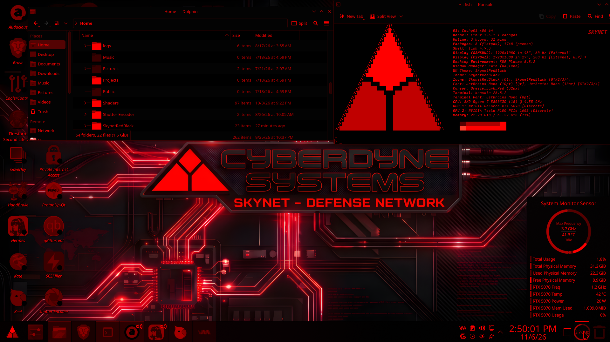

# SkynetRedBlack

A red-on-black Cyberdyne / Skynet themed **global theme for KDE Plasma 6** — one package: colour scheme, redscale icons, Konsole, cursor, wallpaper, sounds, fastfetch greeting.

## Quick install

```bash
git clone https://github.com/kd0frg/SkynetRedBlack.git
cd SkynetRedBlack
./install.sh        # or: ./install.sh -i
```

Short flags: `-i` install (default), `-p` rebuild tarballs, `-o` cyberdyne-off, `-h` help.

Tint all icons red? Prompted on first run (`Y` default). Answer `n` to skip.

## Screenshots




## What's inside

Global theme, `SkynetRedBlack` colour scheme, redscale icon theme, Konsole profile (Courier Prime 12px), cursor `Breeze_Dark_Red`, wallpaper + login, 42 system sounds, fastfetch triforce logo, fish greeting, retint tools.

## Fonts

Terminal font: **Courier Prime (12px)** — SIL OFL. See `assets/fonts/` and `THIRD-PARTY-NOTICES.md`.

## Support

<a href="https://buymeacoffee.com/projectaivolution" target="_blank"></a>

## License

GPLv3. Third-party: Courier Prime (Quote Unquote Apps, SIL OFL). See `LICENSE` and `THIRD-PARTY-NOTICES.md`.
