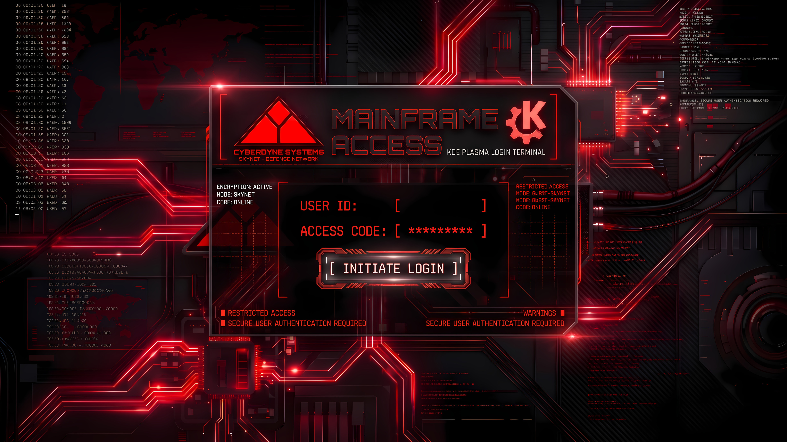

# SkynetRedBlack

**A red-on-black Cyberdyne / Skynet themed global theme for KDE Plasma 6.** One package, one installer: colour scheme, redscale icon theme (every icon on your system re-tinted red), Konsole profile, mouse cursor, desktop + login wallpaper, 42 sound effects, and a fastfetch triforce greeting.

Think "Terminator / Cyberdyne Systems": black everywhere, red for everything else — folders, app icons, panel icons, tray icons, window buttons, selection highlights, terminal, cursor, wallpaper and boot/login screen.

Current version: **v1.0.59** · Repo: https://github.com/kd0frg/SkynetRedBlack

---

## What this is

| Piece | What you get |
|---|---|
| **Global theme (Look & Feel)** | `com.skynetredblack` — sets the colour scheme, icon theme, cursor and sound theme in one shot |
| **Colour scheme** | `SkynetRedBlack.colors` — black backgrounds, red text/accents; greyed-out ("disabled") items become dark maroon `60,0,0` instead of grey |
| **Icon theme** | `SkynetRedBlack` — the whole Breeze set plus Tela/Papirus red folders tinted in; nothing falls back to blue Breeze at any size (~16k+ icons, plus a system-wide SVG scan of anything else you have installed) |
| **Plasma desktop style** | black base, bright-red active highlight; window minimise/maximise/close buttons are red (including Brave, via the system title bar) |
| **Konsole profile** | `SkynetRedBlack.profile` — Courier Prime 12px, red tabs, red cursor, `SKYNET` badge, red focus border |
| **Cursor** | `Breeze_Dark_Red`, 47 cursor shapes, size 32 |
| **Wallpaper + login screen** | `skynet-wallpaper.jpg` (3840×2160) and `login.jpg` (3840×2160) for Plasma Login Manager / SDDM |
| **Sounds** | **Cyberdyne System Sounds — 42 sound effects**, Ogg Vorbis, covering errors, messages, battery, device plug/unplug, login/logout, bell, volume, trash, game-over, etc. |
| **fastfetch greeting** | Cyberdyne triforce ASCII logo + a readout that reports `WM Theme: SkynetRedBlack`, `Theme: SkynetRedBlack`, `Font: Courier Prime (12px)` — cosmetic, does not change your real widget/GTK style |
| **fish greeting** | `fish_greeting` runs the triforce fastfetch on every new terminal |
| **Retint tooling** | `cyberdyne-retint`, `cyberdyne-detint`, `cyberdyne-auto`, `cyberdyne-off` + an optional systemd auto-scanner |

---

## Install — exact commands per distro

Everything below runs the same installer: `git clone`, `cd`, `./install.sh`. Only the dependency-install line differs.

**The installer itself needs:** `git`, `bash`, `tar`, `python3` with **Pillow** (`from PIL import Image`), `gtk-update-icon-cache`, and the KDE Plasma 6 tools (`kpackagetool6`, `kwriteconfig6`, `qdbus6`, `kbuildsycoca6`). Optional: `fastfetch` + `fish` (for the greeting), and `sudo` (only for the login wallpaper). **KDE Plasma 6 must already be running** — this is a Plasma theme, not a desktop environment.

### Arch Linux / CachyOS

```bash
sudo pacman -Syu git python python-pillow gtk3 qt6-tools kde-cli-tools plasma-workspace
git clone https://github.com/kd0frg/SkynetRedBlack.git
cd SkynetRedBlack
./install.sh
```

Optional extras (greeting + login wallpaper):

```bash
sudo pacman -S fastfetch fish
```

### Debian / Ubuntu

> Plasma 6 ships in Debian **trixie** and newer; Debian 12 (bookworm) has Plasma 5. Ubuntu 24.04+ is fine. On bookworm the Pillow package is named `python3-pil` — swap it in below.

```bash
sudo apt update
sudo apt install git python3 python3-pil gtk3 kde-cli-tools plasma-workspace
git clone https://github.com/kd0frg/SkynetRedBlack.git
cd SkynetRedBlack
./install.sh
```

Optional extras:

```bash
sudo apt install fastfetch fish
```

### RHEL / Fedora / AlmaLinux / Rocky

> On RHEL-family you need **CRB** (called "Cody/RPM Builder" repo, aka `codbuilder`) for KDE/python extras, and Plasma installed (`plasma-desktop`). Fedora already has it.

```bash
sudo dnf install -y crb
sudo dnf groupinstall -y "Plasma Desktop" 2>/dev/null || sudo dnf install -y plasma-desktop
sudo dnf install -y git python3 python3-pillow gtk3 qt6-qtbase kde-cli-tools plasma-workspace
git clone https://github.com/kd0frg/SkynetRedBlack.git
cd SkynetRedBlack
./install.sh
```

Optional extras:

```bash
sudo dnf install -y fastfetch fish
```

### No git? Download the tarballs instead

The release tarballs are tracked in the repo, so a clone installs out of the box. If you skip git, grab the tarballs from [Releases](https://github.com/kd0frg/SkynetRedBlack/releases) into a `releases/` folder next to `install.sh` — it falls back to extracting them for any component whose source folder is missing (`icons/` and `cursors/` are gitignored on purpose). Verify with `sha256sum -c SHA256SUMS`.

### Install from the KDE Store instead

System Settings → Appearance → **Global Theme** → Get New Global Themes, or these listings:

- Global theme — https://store.kde.org/p/2381294
- Icons — https://store.kde.org/p/2381288
- Colour scheme — https://store.kde.org/p/2381290
- Konsole — https://store.kde.org/p/2381291
- Wallpaper — https://store.kde.org/p/2381292
- Cursor — https://store.kde.org/p/2381293
- Cyberdyne System Sounds — https://store.kde.org/p/2381359

(Sounds and Konsole are standalone listings: KDE has no KNewStuff type for sound themes or Konsole profiles, so they can't be auto-pulled as global-theme dependencies.)

---

## `install.sh` — every command, in plain terms

Short flags: `-i`, `-p`, `-o`, `-h`. Long flags below them. Run them from inside the cloned folder.

| Type this | What it does, plainly |
|---|---|
| `./install.sh` | **The full install.** Installs the icon theme and runs the whole tint pipeline, copies the colour scheme, Konsole profile, cursor, wallpaper + login wallpaper, sound theme, fastfetch/fish greeting, sets KWin to the red window buttons, points Dolphin and the global config at the red theme, registers the global theme, rebuilds caches and **restarts the Plasma shell** so everything applies immediately. Asks you one question first (see below). |
| `./install.sh -i` | Same thing. `-i` is just the explicit spelling of the default. |
| `./install.sh -h` | **Help.** Prints the short flag list and exits. Changes nothing. |
| `./install.sh -p`<br>`./install.sh --pack` | **Rebuild the release tarballs** from this checkout into `releases/` (look-and-feel, colourscheme, konsole, cursor, wallpaper, sounds, icons). It shows sizes, the packaged version, SHA-256 checksums, and test-installs the look-and-feel package. Does **not** install anything on your desktop. Use it when you're preparing a release. |
| `./install.sh --cyberdyne-enable` | **Turn the auto-scanner ON** without reinstalling the theme. Installs and enables two systemd user units: `cyberdyne-retint.path` (fires instantly when a new app is installed) and `cyberdyne-retint.timer` (a weekly safety-net run). New apps get red icons without you doing anything. |
| `./install.sh --cyberdyne-disable` | **Turn the auto-scanner OFF.** Stops, disables and deletes those two units. Your red icons stay exactly as they are; nothing runs automatically any more. |
| `./install.sh --cyberdyne-off`<br>`./install.sh -o` | **Turn OFF everything automatic in one shot**: removes the scanner units *and* disables the Plasma-shell restart that retint/detint would otherwise do. Icons are **not** detinted — the red stays. Re-tint by hand anytime with `cyberdyne-retint`; restore the auto behaviour with `--cyberdyne-enable` + `cyberdyne-auto shell-restart enable`. |
| `./install.sh --with-auto-retint` | **Full install, plus** the auto-scanner enabled at the end (timer + instant watcher). |

### The prompt it asks you first

> `Tint all icons red? [Y/n]`

- **Y / yes / just press Enter** (default) → installs the red icon theme and runs all the tinting.
- **n / no** → skips the icon theme and the tinting pipeline entirely; KDE stays on `breeze`. Everything else (colours, Konsole, cursor, wallpaper, sounds, greeting) still installs, and the retint tools are still installed, so you can tint later with `cyberdyne-retint` — it builds the theme and its database from scratch on its first run, no installer needed.

### The four commands it leaves you with

Installed to `~/.local/bin`, so they're available anywhere after install:

| Command | Plain meaning |
|---|---|
| `cyberdyne-retint` | Re-run the tinting. Uses the icon/app database, so it only tints **new or changed** apps/icons instead of rescanning everything. Flags: `--apps-only` (app icons only), `--bright` (make everything bright `#ff0000`), `--force` (re-tint icons that are already red). Restarts the Plasma shell only if icons actually changed. |
| `cyberdyne-detint` | The reverse: removes the tinted red copies so KDE falls back to the original Breeze/hicolor icons. Flags: `--apps-only`, `--dry-run` (preview, changes nothing), `--no-shell-restart`, and `--total` / `--uninstall` = the full uninstall (theme folder, icon/app database, retint/detint/auto scripts and systemd units removed, icon theme set back to `breeze`; your colour scheme, wallpaper, cursor and Konsole are left alone). |
| `cyberdyne-auto` | Toggle switch for the automatic bits: `enable` / `disable` / `status` for the scanner, and `shell-restart enable|disable|status` for whether a retint/detint bounce is allowed to restart plasmashell. No argument = shows status. |
| `cyberdyne-off` | One command to switch off **both** at once: scanner units removed and shell-restart disabled, icons untouched. `--status` to check, `--enable` to bring the auto stack back. |

Where things land, if you ever want to look by hand:

- icons → `~/.local/share/icons/SkynetRedBlack`
- colour scheme → `~/.local/share/color-schemes/SkynetRedBlack.colors`
- Konsole → `~/.local/share/konsole/`
- cursor → `~/.icons/Breeze_Dark_Red`
- wallpaper/login → `~/.local/share/wallpapers/SkynetRedBlack/` (login also `/usr/share/wallpapers/SkynetRedBlack/`)
- sounds → `~/.local/share/sounds/Cyberdyne-System-Sounds`
- greeting → `~/fastfetch/skynet.json` + `~/fastfetch/skynet.txt`, fish fragment appended to `~/.config/fish/config.fish`
- icon/app database (local cache, safe to delete) → `~/.local/share/SkynetRedBlack/icon-db.sqlite3`
- scanner units → `~/.config/systemd/user/cyberdyne-retint.{service,timer,path}`
- shell-restart switch → `~/.config/SkynetRedBlack/shell-restart`

If something looks stale after installing, restart the affected app: `systemctl --user restart plasma-plasmashell.service`, or `dolphin --replace &`.

---

## Login screen

Plasma Login Manager (CachyOS's successor to SDDM) only lets you customise the **wallpaper** and **colour scheme** — no custom QML login themes. So the custom login screen here is `login.jpg` (3840×2160) over the SkynetRedBlack colour scheme.

- With passwordless `sudo`, the installer copies it to `/usr/share/wallpapers/SkynetRedBlack/login.jpg` (the `plasmalogin` user can't read your home dir) and sets it automatically.
- Without it, the installer prints the manual path: copy the file to `/usr/share/wallpapers/SkynetRedBlack/`, then System Settings → **Login Screen** → Background → pick it.

---

## Screenshots




---

## Fonts

Terminal font: **Courier Prime (12px)** — SIL Open Font License, Quote Unquote Apps (https://quoteunquoteapps.com/courierprime/). See `assets/fonts/` and `THIRD-PARTY-NOTICES.md`.

---

## Changelog

Full history lives in [`CHANGELOG.md`](CHANGELOG.md) — newest version at the top. GitHub releases: https://github.com/kd0frg/SkynetRedBlack/releases

---

## License

Split license, because the package ships tinted derivatives of copyleft artwork:

- **MIT** — the author's own work: `install.sh`, `scripts/*.py`, colour scheme, Konsole profile, look-and-feel defaults, fastfetch/fish fragments, packaging.
- **GPL-3.0** — Tela and Papirus derived artwork (red folders, Steam), and the `Breeze_Dark_Red` cursor (fbm224 / Erwin-Iosef).
- **LGPL-3.0** — tinted Breeze icon derivatives (KDE Community).
- **SIL OFL** — Courier Prime (referenced, not bundled).

Full texts and attribution: `LICENSE`, `LICENSES/GPL-3.0.txt`, `LICENSES/LGPL-3.0.txt`, `THIRD-PARTY-NOTICES.md`. No trademark or endorsement implied — Steam, KDE, Breeze, Tela, Papirus, JetBrains and CachyOS names/logos belong to their owners.

## Support

<a href="https://buymeacoffee.com/projectaivolution" target="_blank"></a>
